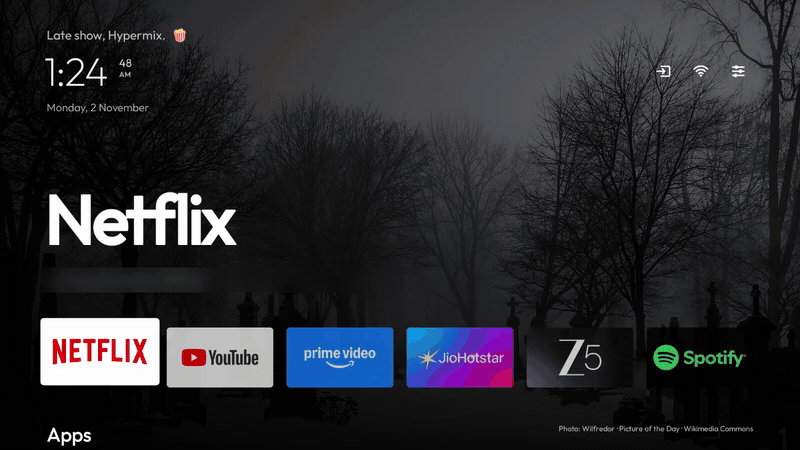
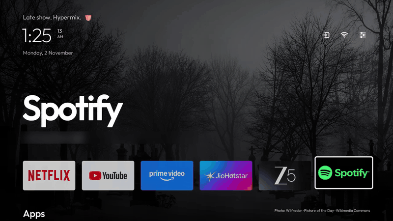
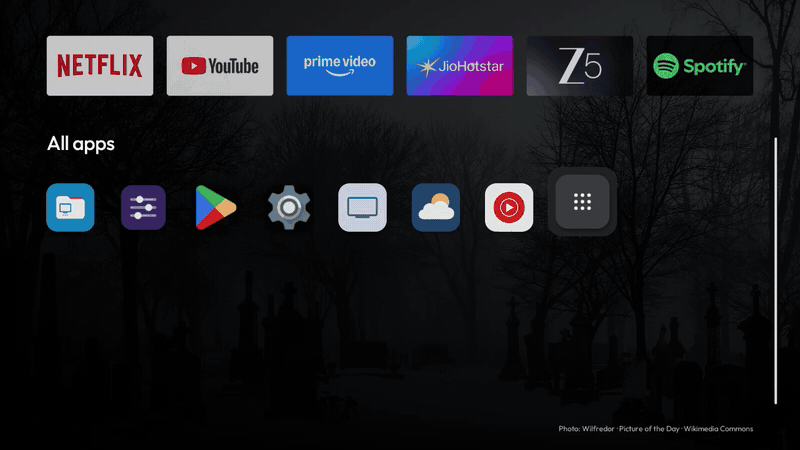
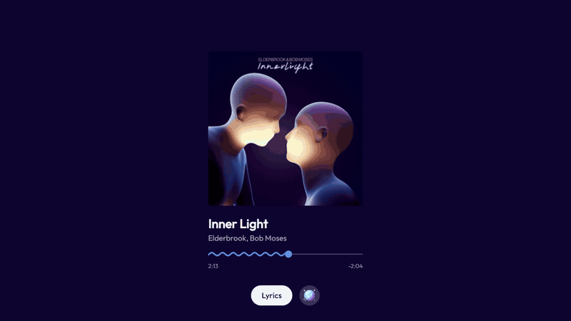
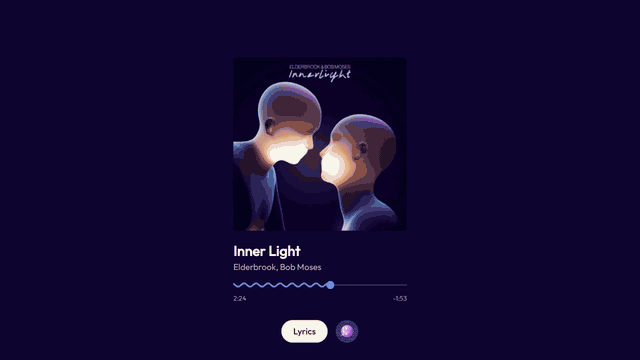

<h1 align="center">vibe-tv</h1>

<p align="center"><b>A home screen and screensaver for Android TV that play along with your music.</b><br>
No ads, no account, nothing to sign in to. Made by Hypermix. 🎶📺<br>
<sub>✨ A vibe-coded project, built with Claude Opus 5.5.</sub></p>

<p align="center"></p>

## 👀 At a glance

**✅ What you get**

- A calm home screen: the day's photo, a greeting, the clock and a dock of your favourite apps
- Every app you use one press away, plus an All apps page you can search by typing or voice
- A music screen with lyrics and a party mode, whenever a music app is playing
- A photo screensaver with the time and the weather
- Home settings to change your name, city, screensaver, dock and more

**🚫 What you don't get**

- No ads, no suggested shows and no "continue watching" rows
- No music screen over YouTube, Netflix or other video apps
- No account, no sign-in and no tracking
- No phones or Fire TV: it is made for Android TV and Google TV, Android 8 or later

## 🏠 Home screen

- 🖼️ **A new photograph every day:** Wikimedia Commons' Picture of the Day, the same one all day.
- 👋 **A greeting with your name** that changes every minute (funny lines for the time of day, each with an animated emoji), the clock with seconds and the date.
- ⏰ **Alarms and timers:** when one is set, the date slides over to show it ("Alarm · 7:30 am", or a timer counting
  down), and the clock becomes a shortcut to the alarm or timer app.
- 📶 **Inputs, Wi-Fi, New wallpaper and the TV's Settings** at the top right, each named in a small pop-up when you land on it. The Wi-Fi icon shows your signal strength, like a phone's.
- 🔤 **The focused app's name set large,** with what you last played in it.
- 🧲 **A dock of up to 10 apps,** which resizes itself to fit.

<p align="center"></p>

### 📱 Apps

Press Down for every app you use, laid out like a phone's: rounded icons with a ripple when you arrive and a soft
spring as you move. Only the apps you installed (and the TV's own Live TV, Settings and Play Store) are shown; the
TV's hidden system parts are left out. The last tile opens All apps.

**Hold OK on any app** to move it, add it to the dock or take it off, hide it from Home, open its info, or
uninstall it.

<p align="center"></p>

### 🔎 All apps

- 🎤 **Search by typing or by voice:** press the mic and say the app's name. The button next to it opens the TV's own
  voice assistant (Google Assistant on Google TV).
- 🪟 **A preview panel** for the focused app: when you last opened it, what you last played, its size, version and
  install date. You can turn it off in Home settings; then the app's name is shown large instead.
- The title and search stay put while the icons scroll, with a scroll bar on the right.

<p align="center"></p>

## 🎵 Music screen

Leave a music app playing (Spotify, YouTube Music, Apple Music, Amazon Music, JioSaavn, Gaana, Tidal, Deezer or any
other music app) and after a minute without a button press the TV turns into the album. The TV stays on for as long
as the music plays. Video apps such as YouTube, Netflix or Prime Video never bring it up: those are for watching.

<p align="center"></p>

- 💿 **The cover** on its own main colour, with the title, the artist and a wavy timeline in the cover's second
  colour. Long names glide across and back.
- 🎤 **Lyrics** in time with the song, in its own language and script, from [LRCLIB](https://lrclib.net). Songs
  without lyrics get a joke instead.
- 🪩 **Party mode** (the disco ball): the cover's colours wash across the whole screen and change with the beat, with
  a flash and a glow on the bass.

<p align="center"></p>

## 🌄 Screensaver

With no music playing, the screensaver shows Wikimedia Commons' featured photographs of nature, landscapes, the sea
and space. A new one comes every 90 seconds, with the time at the bottom left and the weather at the bottom right.
The TV does not turn itself off.

<p align="center"></p>

## ⚙️ Home settings

Open **Home settings** from the Apps row or All apps. It is named so it is not confused with the TV's own Settings.

| Setting | What it does |
|---|---|
| Your name | Shown in the greeting |
| Weather city | Left and Right pick Automatic (found from your internet address), a city from the list, or "Type a city" |
| Screensaver after | 1, 2, 5, 10 or 30 minutes without a button press |
| Music screen | On or off. Off, the photo screensaver shows while music plays too |
| Photo screensaver | On or off. With both off there is no screensaver, and the TV stays on |
| Dock holds up to | 4 to 10 apps |
| Icons per row in Apps | 6 to 10 |
| Seconds on the clock | On or off |
| Greeting emoji | On or off |
| Preview panel in All apps | On or off |

## 🛠️ Install

You need a Mac or Linux computer with JDK 17 and the Android SDK (platform 34, build-tools 34, platform-tools),
and an Android TV or Google TV with network debugging switched on.

1. **Get the code:**

   ```bash
   git clone https://github.com/hypermix94/vibe-tv.git
   cd vibe-tv
   ```

2. **Make it yours (optional).** Add these to `local.properties`, which stays on your computer. All of them can
   also be changed later in Home settings.

   ```properties
   vibetv.name=Alex
   vibetv.weatherPlace=London
   vibetv.weatherLatitude=51.5072
   vibetv.weatherLongitude=-0.1276
   vibetv.dock=com.netflix.ninja,com.google.android.youtube.tv,com.spotify.tv.android
   ```

3. **Build and install:**

   ```bash
   TV_HOST=192.168.1.50 ./install.sh
   ```

   Use your TV's address. The first time, the TV asks you to allow this computer. The script installs vibe-tv,
   makes it the screensaver and gives it the permissions below.

4. **Make it Home.** Press Home on the remote and pick vibe-tv, or run:

   ```bash
   adb -s 192.168.1.50:5555 shell cmd package set-home-activity io.github.hypermix94.vibetv/.HomeActivity
   ```

5. **Switch network debugging off** on the TV when you are done.

If you ever want your TV's own home screen back, choose it as Home in Settings, or switch it on again with
`adb shell pm enable` and its package name (on Google TV, `com.google.android.apps.tv.launcherx`).

### 🔐 Permissions

| Permission | Why |
|---|---|
| Notification access | To see what is playing, and the timers and alarms for the clock |
| Record audio | Party mode listens to the TV's own sound through Android's Visualizer; voice search uses the mic only when you press it |
| Write secure settings | To keep the TV awake while music plays, and to switch the screensaver on or off |
| Modify system settings | To change the screensaver delay |
| Usage access | To show each app's size in the preview panel |
| Internet | Lyrics, weather and photographs (see Privacy) |

## 🛡️ Privacy

- **No account, no tracking, no ads.**
- **The internet is used for these things only,** none of which needs a key:
  - lyrics, from [LRCLIB](https://lrclib.net);
  - the weather, from [Open-Meteo](https://open-meteo.com);
  - your city, from [ipwho.is](https://ipwho.is), only if you set the weather city to Automatic;
  - the photographs, from [Wikimedia Commons](https://commons.wikimedia.org);
  - the animated emoji in the greeting and the party button's disco ball, from Google's Noto emoji.
- **The music screen only hears what the TV is playing.** The microphone is used only when you press the mic.
- **Notifications are not read,** except those of timers and alarms, so the clock can show them.

## ⚡ Performance

Measured on a Sony BRAVIA 2 II (Google TV, Android 12, 2.4 GB RAM): Home opens in 540–635 ms from cold and
150–262 ms when it is already in memory, and uses about 56 MB while on screen. The APK is under 140 KB.

## 🚧 Limits

- Made and tested on one Sony Google TV. Other Android TVs should work, but buttons and system apps differ.
- The music screen needs a music app that shows a media notification; most do.
- Lyrics exist only for songs LRCLIB knows.
- Voice search needs Google's speech services on the TV.

## 📄 Licence

[MIT](LICENSE), © hypermix94. The Outfit typeface is used under the [SIL Open Font License](fonts/FONT-LICENSE-OFL.txt).
Photographs belong to their photographers and are credited on screen.
