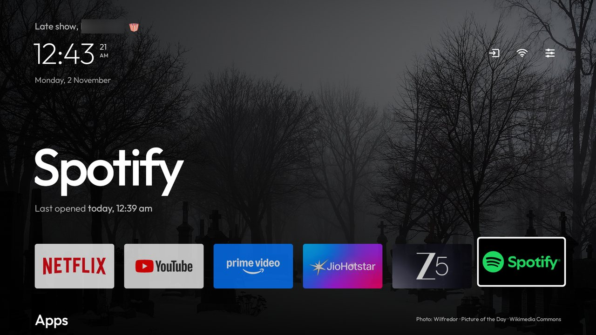
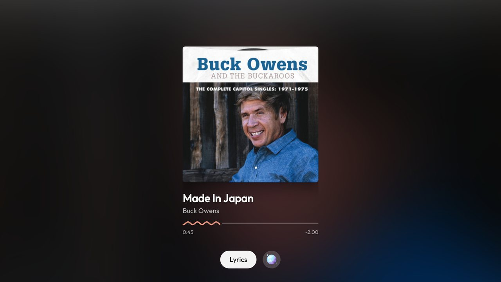
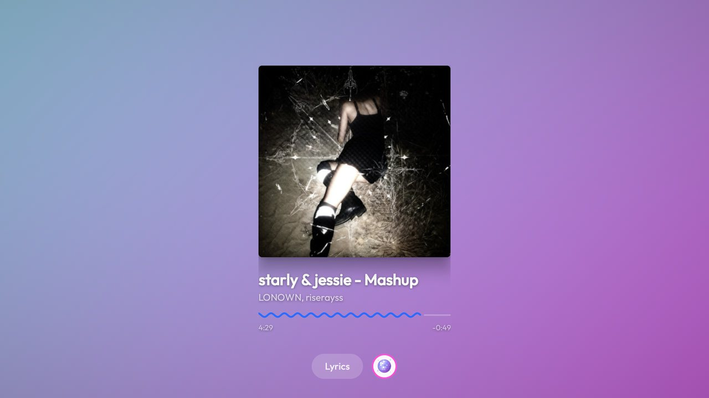
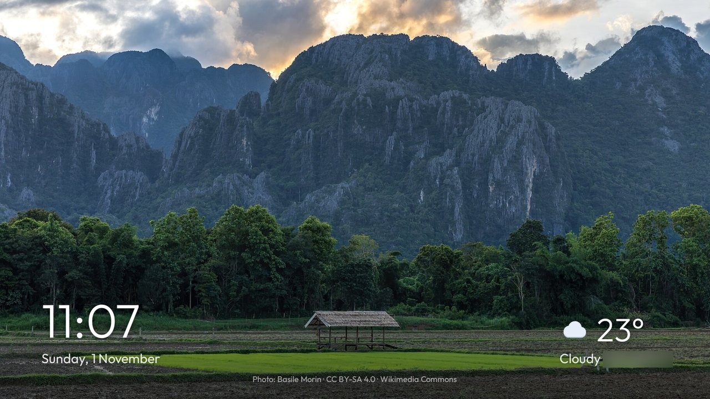

<h1 align="center">vibe-tv</h1>

<p align="center"><b>A home screen and screensaver for Android TV that play along with your music.</b><br>
No ads, no account, nothing to sign in to.</p>

<p align="center"></p>

## Home screen

- **A new photograph every day** fills the screen: Wikimedia Commons' Picture of the Day.
- **A greeting, the clock with seconds and the date** at the top left. Inputs, Wi-Fi and Settings sit at the top
  right, each with its own small animation when you land on it.
- **The focused app's name set large,** with when you last opened it.
- **A dock of six apps,** and every other app one press of Down away.
- **Hold OK on any app** to move it along the dock, add it to the dock, open its info or uninstall it.

## Music screen

Leave Spotify, YouTube Music or YouTube playing for two minutes and the TV turns into the album. The TV stays on
for as long as the music plays.

<p align="center"></p>

- **The cover** on a field of its own main colour, with the title, the artist and a wavy timeline in the cover's
  second colour. Long names glide across.
- **Lyrics** in time with the song, in the song's own language and script, from [LRCLIB](https://lrclib.net).
  Songs without lyrics get a joke instead.
- **Party mode** (the disco ball): the cover's colours flow across the whole screen like liquid, surging with the
  bass.

<p align="center"></p>

## Screensaver

With nothing playing, the screensaver shows Wikimedia Commons' featured photographs of nature, landscapes, the sea
and space. A new one comes every 90 seconds, with the time, the weather and the photographer's name.

<p align="center"></p>

## Install

You need a Mac or Linux computer with JDK 17 and the Android SDK (platform 34, build-tools 34, platform-tools),
and an Android TV or Google TV on Android 8 or later with network debugging switched on.

1. **Get the code:**

   ```bash
   git clone https://github.com/hypermix94/vibe-tv.git
   cd vibe-tv
   ```

2. **Make it yours (optional).** Add these to `local.properties`, which stays on your computer:

   ```properties
   vibetv.name=Alex
   vibetv.weatherPlace=London
   vibetv.weatherLatitude=51.5072
   vibetv.weatherLongitude=-0.1276
   vibetv.dock=com.netflix.ninja,com.google.android.youtube.tv,com.spotify.tv.android
   ```

3. **Build and install:**

   ```bash
   TV_HOST=192.168.1.50 ./install.sh
   ```

   Use your TV's address. The first time, the TV asks you to allow this computer. The script installs vibe-tv
   and makes it the screensaver.

4. **Make it Home.** Press Home on the remote and pick vibe-tv, or run:

   ```bash
   adb -s 192.168.1.50:5555 shell cmd package set-home-activity io.github.hypermix94.vibetv/.HomeActivity
   ```

5. **Switch network debugging off** on the TV when you are done.

If you ever want your TV's own home screen back, choose it as Home in Settings, or switch it on again with
`adb shell pm enable` and its package name (on Google TV, `com.google.android.apps.tv.launcherx`).

## Privacy

- **No account, no tracking, no ads.**
- **The internet is used for four things,** none of which needs a key:
  - lyrics, from [LRCLIB](https://lrclib.net);
  - the weather, from [Open-Meteo](https://open-meteo.com);
  - the photographs, from [Wikimedia Commons](https://commons.wikimedia.org);
  - the animated greeting characters, from Google's Noto emoji.
- **The music screen only hears what the TV is playing,** through Android's Visualizer. The microphone is used only
  when you press the mic to search for an app.
- **Notifications are not read,** except those of timers and alarms, so the clock can show them.

## Licence

[MIT](LICENSE), © hypermix94. The Outfit typeface is used under the [SIL Open Font License](fonts/FONT-LICENSE-OFL.txt).
Photographs belong to their photographers and are credited on screen.
